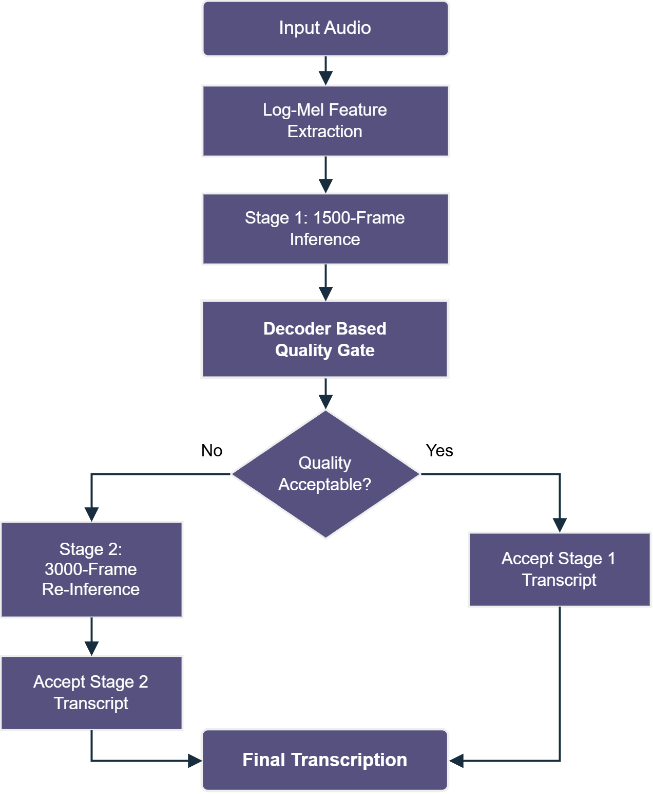

# korkutWhisper

`korkutWhisper` is a local **CTranslate2 / faster-whisper** speech-to-text inference library implementing **decoder-guided selective re-inference (`g2`)** for short-form audio (`<= 1500` Mel content frames, ~15 seconds).

Instead of unconditionally encoding every short audio clip with Whisper's full 30-second (`3000`-frame) encoder context, `korkutWhisper` first runs a fast **Stage 1 (`1500`-frame)** pass, evaluates a calibrated **Decoder-Based Quality Gate (`decoder_based_b2`)** over decoder output statistics (`avg_logprob` and `compression_ratio`), and selectively triggers a **Stage 2 (`3000`-frame)** re-inference pass **only** when the computed risk score meets or exceeds the decision threshold—reusing the already extracted log-Mel spectrogram without re-decoding the audio.

---

## System Overview & Architecture



As illustrated in the system diagram above, every transcription request under the default `g2` strategy follows a deterministic two-stage pipeline:

1. **Input Audio & Validation (`<= 1500` Mel Frames):**
   - Audio files are decoded via **PyAV** into 16 kHz mono 16-bit PCM and normalized to `[-1.0, 1.0]` `float32`. In-memory NumPy arrays are validated, downmixed, and resampled to 16 kHz via polyphase filtering.
   - The current release strictly enforces `1 <= actual_mel_frames <= 1500` (~15 seconds). Any input exceeding `1500` Mel content frames immediately raises `UnsupportedAudioLengthError` (silent truncation is forbidden; long-form chunking is planned for future work).
2. **Log-Mel Feature Extraction (Executed Once):**
   - The 128-bin log-Mel spectrogram is computed **once** on the input waveform and cached in memory.
3. **Stage 1: 1500-Frame Inference:**
   - The cached Mel spectrogram is zero-padded to exactly `1500` frames and passed through the CTranslate2 Whisper encoder and decoder using a deterministic seed derived from `seed|audio_id|1500`.
4. **Decoder-Based Quality Gate (`decoder_based_b2`):**
   - The gate extracts the segment-level mean `avg_logprob` and `compression_ratio` from Stage 1 (imputing missing/non-finite values with calibration medians if needed) and computes a linear risk score using the SHA-256 verified parameters in [`src/korkutwhisper/profiles/decoder_based_b2.json`](src/korkutwhisper/profiles/decoder_based_b2.json):
     $$\text{risk\_score} = w_{\text{lp}} \cdot \frac{\text{logprob} - \mu_{\text{lp}}}{\sigma_{\text{lp}}} + w_{\text{cr}} \cdot \frac{\text{compression} - \mu_{\text{cr}}}{\sigma_{\text{cr}}}$$
   - Note: `risk_score` is a linear decision metric, **not** a calibrated probability.
5. **Quality Acceptable? (`risk_score < threshold` vs. `risk_score >= threshold`):**
   - **Yes (`risk_score < 0.07826304331214909`):** Stage 1 transcript is accepted immediately (`final_stage = 1`, `retry_performed = False`), saving the cost of a 3000-frame pass.
   - **No (`risk_score >= 0.07826304331214909`):** **Stage 2: 3000-Frame Re-Inference** is triggered (`final_stage = 2`, `retry_performed = True`), reusing the **exact same cached Mel spectrogram** padded to `3000` frames with seed `seed|audio_id|3000`, and accepting the Stage 2 transcript as the **Final Transcription**.

---

## Installation

Requires Python 3.10+ and locally available dependencies (`faster-whisper==1.2.1`, `ctranslate2>=4.0`, `numpy>=1.24`, `scipy>=1.10`, `av>=11`).

```bash
cd korkutWhisper
pip install -e .
```

For an offline environment where dependencies are already installed:

```bash
pip install -e . --no-deps --no-build-isolation
```

Model files must be stored locally (`local_files_only=True`); the library never downloads weights over the network.

---

## Python API Usage

### 1. Basic Transcription & GPU Warm-Up

Using `warmup=True` (or calling `model.warmup()`) runs a 1-second silent pass upon initialization so that CUDA / cuBLAS / CTranslate2 kernels are pre-initialized before timing real audio files:

```python
from korkutwhisper import KorkutWhisper

with KorkutWhisper(
    model_path="./large-V3-turbo-exp2-LoRA-ct2-int8",
    device="cuda",
    compute_type="int8",
    allow_unverified=True,
    warmup=True,
) as model:
    result = model.transcribe("3487.wav")
    print(result.text)
```

You can also trigger warm-up manually at any time (including warming up both `1500`-frame and `3000`-frame encoder windows):

```python
warmup_ms = model.warmup(duration_seconds=1.0, include_retry_window=True)
```

---

### 2. Output Formats & File Export

Every `TranscriptionResult` supports multiple built-in output representations and automatic extension-aware saving:

```python
# 1. Plain text (.txt)
print(result.to_text())

# 2. Multi-line human-readable diagnostic report (routing, G2 risk score, stage timings, RTF, text)
print(result.to_report())

# 3. Pretty-printed JSON string & file export (.json)
print(result.to_json(indent=2))
result.save_json("output.json")

# 4. Flattened 26-column CSV row dict & CSV string (.csv)
row_dict = result.to_csv_row()
print(result.to_csv(include_header=True))

# 5. SubRip (.srt) and WebVTT (.vtt) subtitle formats
print(result.to_srt())
print(result.to_vtt())

# 6. Unified format() and extension-inferred save()
print(result.format("report"))  # 'text', 'txt', 'report', 'json', 'csv', 'srt', 'vtt'
result.save("output.srt")
result.save("output.csv")
result.save("output.json")
```

---

### 3. CPU-Only Pre-Inference Audio & Dataset Inspection (`inspect_audio` / `inspect_dataset`)

Because the library strictly enforces `<= 1500` Mel content frames (~15 seconds), you can inspect a single audio file or an entire dataset directory **on CPU without loading the GPU model**:

```python
from korkutwhisper import inspect_audio, inspect_dataset

# Version 1: Inspect a single audio file or NumPy array
info = inspect_audio("3487.wav")
print(info.to_report())
# info.valid -> True, info.status -> 'eligible', info.actual_mel_frames -> 528

# Version 2: Inspect an entire directory or list of audio files
dataset_info = inspect_dataset("./audio_folder", pattern="*.wav", recursive=True)
print(dataset_info.to_report())
dataset_info.save_csv("dataset_health.csv")

# Pass only the verified <=1500-frame eligible files directly to transcribe_many():
eligible_files = dataset_info.eligible_paths()
```

---

### 4. Sequential Batch & Array Transcription

```python
from korkutwhisper import save_batch_csv, save_batch_jsonl

# Transcribe a batch sequentially; per-item errors are captured in BatchItem without aborting
items = model.transcribe_many(["3487.wav", "1.wav"])
for item in items:
    if item.result is not None:
        print(item.index, item.result.text)
    else:
        print(item.index, f"{item.error_type}: {item.error_message}")

# Export batch outcomes (including both successful items and errors) to CSV or JSONL
save_batch_csv(items, "batch_results.csv")
save_batch_jsonl(items, "batch_results.jsonl")

# Transcribe an in-memory NumPy array (automatically resampled to 16 kHz mono)
result_arr = model.transcribe_array(samples, sample_rate=48000, audio_id="clip_01")
```

---

### 5. JSON Gate Profile (`decoder_based_b2.json`) & SHA-256 Integrity Check

Calibration constants for the G2 gate are stored in [`src/korkutwhisper/profiles/decoder_based_b2.json`](src/korkutwhisper/profiles/decoder_based_b2.json) rather than hardcoded as magic numbers in logic code:

- At load time, `load_gate_profile()` computes the LF-normalized SHA-256 hash of `decoder_based_b2.json` and verifies it against `VERIFIED_PROFILE_HASHES['decoder_based_b2']` (`70e68351003baabf12a6371c32c155aaa0d44f4eb535e141e189aac0c9d23e37`).
- If the JSON file is modified or a custom external profile is supplied via `GateConfig(profile_path="custom.json")`, `verified` becomes `False`. Running with an unverified profile requires `allow_unverified=True`.

---

## Command-Line Interface (CLI)

You can use `korkutwhisper` directly from the terminal (or via `python -m korkutwhisper`):

```bash
# 1. Single-file transcription with warm-up, report display, and SRT export
python -m korkutwhisper --model ./large-V3-turbo-exp2-LoRA-ct2-int8 3487.wav \
    --allow-unverified --warmup --format report --output 3487.srt

# 2. Batch transcription exported to CSV or JSONL
python -m korkutwhisper --model ./large-V3-turbo-exp2-LoRA-ct2-int8 3487.wav 1.wav \
    --allow-unverified --format csv --output batch.csv

# 3. CPU-only pre-inference inspection of a single file or directory (no GPU/model needed)
python -m korkutwhisper --inspect 3487.wav
python -m korkutwhisper --inspect . --pattern "*.wav" --output inspection.csv

# 4. Inspect the active G2 profile parameters and SHA-256 verification status
python -m korkutwhisper --gate-info
```

---

## Routing Rules & Short-Form Scope (`<= 1500` Mel Frames)

| Input Mel Content Frames | `g2` Strategy | `fixed_1500` Strategy | `fixed_3000` Strategy |
| :--- | :--- | :--- | :--- |
| `<= 0` frames | Raises `UnsupportedAudioLengthError` | Raises `UnsupportedAudioLengthError` | Raises `UnsupportedAudioLengthError` |
| `1 – 1500` frames (~0–15s) | Stage 1 (`1500` frames) $\rightarrow$ G2 Gate $\rightarrow$ Optional Stage 2 (`3000` frames) | Single pass (`1500` frames, gate bypassed) | Single pass (`3000` frames, gate bypassed) |
| `> 1500` frames (> ~15s) | Raises `UnsupportedAudioLengthError` | Raises `UnsupportedAudioLengthError` | Raises `UnsupportedAudioLengthError` |

> **Future Work (Planned Long-Form Chunking):**  
> In the current release, any audio exceeding `1500` Mel content frames (~15 seconds) is rejected with `UnsupportedAudioLengthError`. Future work will introduce a pre-routing chunking layer that splits `> 1500`-frame recordings into `<= 1500`-frame windows, routes each chunk through the G2 gate independently, and offsets segment `start`/`end` timestamps across chunks.

---

## Tests

```bash
# Run unit and integration test suites
PYTHONPATH=src python -B -m pytest tests/unit tests/integration

# Run opt-in Experiment 06 regression tests (requires CUDA model, Test audio, and archive CSV)
KORKUTWHISPER_REGRESSION=1 PYTHONPATH=src python -B -m pytest tests/regression -v
```

See [`docs/architecture.md`](docs/architecture.md), [`docs/api_reference.md`](docs/api_reference.md), [`docs/configuration.md`](docs/configuration.md), [`docs/experimental_validation.md`](docs/experimental_validation.md), and [`docs/limitations.md`](docs/limitations.md) for detailed technical documentation.
