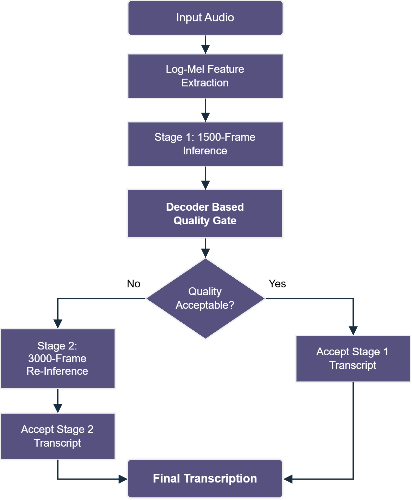

# Architecture

## 1. End-to-End Inference Pipeline

`KorkutWhisper` owns a single local `faster_whisper.WhisperModel` (v1.2.1) instance for its lifetime and serializes all runtime operations through a process-wide reentrant lock (`GLOBAL_LOCK`).

1. **Audio Decoding & Normalization (`korkutwhisper.audio`):**
   - File inputs are decoded with PyAV (`AudioResampler(format='s16', layout='mono', rate=16000)`) and scaled to `[-1.0, 1.0]` `float32`.
   - In-memory NumPy arrays are validated for finiteness, channel count (`1–8` channels downmixed to mono), and amplitude bounds, then resampled to 16 kHz via SciPy `resample_poly`.
2. **Single-Pass Log-Mel Extraction (`CTranslateBackend.extract`):**
   - The 128-bin log-Mel spectrogram is computed **once** per transcription call.
   - Its content frame count is `actual = mel.shape[-1] - 1` (`len(wave) // 160`).
3. **Short-Form Routing Policy (`korkutwhisper.strategies.Strategy`):**
   - Strictly enforces `1 <= actual <= 1500` Mel content frames (~15 seconds).
   - Inputs with `actual <= 0` or `actual > 1500` immediately raise `UnsupportedAudioLengthError`.
   - Under `g2`, eligible inputs start with a `1500`-frame encoder window and `use_gate=True`.
4. **Controlled Window Execution (`controlled_window` in `korkutwhisper.backend.ctranslate`):**
   - Temporarily patches `model.feature_extractor.__class__` to return the cached `mel` matrix without recomputation, and replaces `faster_whisper.transcribe.pad_or_trim` with a strict padding function that pads to `target` (`1500` or `3000`) frames while forbidding truncation.
   - Wraps `model.encode` and `model.generate_with_fallback` to record exact tensor shapes and wall-clock stage durations (`encoder_ms`, `decoder_ms`).
   - Restores all original attributes and module functions in a `finally` block.
5. **Decoder-Based Quality Gate (`korkutwhisper.gates.g2.G2Gate`):**
   - Loads calibration constants from [`profiles/decoder_based_b2.json`](../src/korkutwhisper/profiles/decoder_based_b2.json) and verifies the file's SHA-256 digest against `VERIFIED_PROFILE_HASHES`.
   - Computes the linear risk score from standardized `avg_logprob` and `compression_ratio` across Stage 1 segments.
   - If `risk_score < threshold`, accepts Stage 1 output (`final_stage = 1`).
   - If `risk_score >= threshold`, triggers Stage 2 re-inference at `3000` frames reusing the cached `mel` spectrogram (`final_stage = 2`, `retry_performed = True`).

## 2. Process Synchronization & Resource Ownership

- `faster-whisper` 1.2.1 relies on a module-global `pad_or_trim` function, and CTranslate2 uses a process-global random number generator (`ctranslate2.set_random_seed`).
- `GLOBAL_LOCK` serializes all `KorkutWhisper` instances within the same Python process, but cannot prevent interference from unrelated external threads calling `faster-whisper` directly at the same time.
- `transcribe_many` processes items sequentially (`max_concurrency=1`) and wraps per-item `KorkutWhisperError` exceptions into `BatchItem` containers.

## 3. Planned Future Work: Long-Form Audio Chunking (`> 1500` Mel Frames)

Currently, audio inputs exceeding `1500` Mel frames (~15 seconds) are rejected by `Strategy.route()` with `UnsupportedAudioLengthError`. In a future release, a pre-routing chunking layer will:
1. Partition `> 1500`-frame waveforms into `<= 1500`-frame windows (via fixed windows or silence-aware splitting),
2. Route each chunk independently through the `g2` gate (so clear chunks finish in 1500 frames and difficult chunks retry at 3000 frames),
3. Offset per-chunk segment `start` and `end` timestamps to assemble full long-form transcripts and `.srt`/`.vtt` subtitles.
